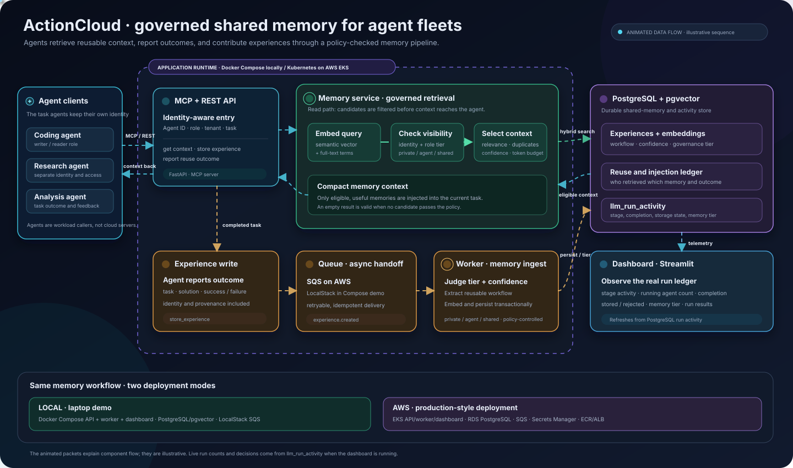
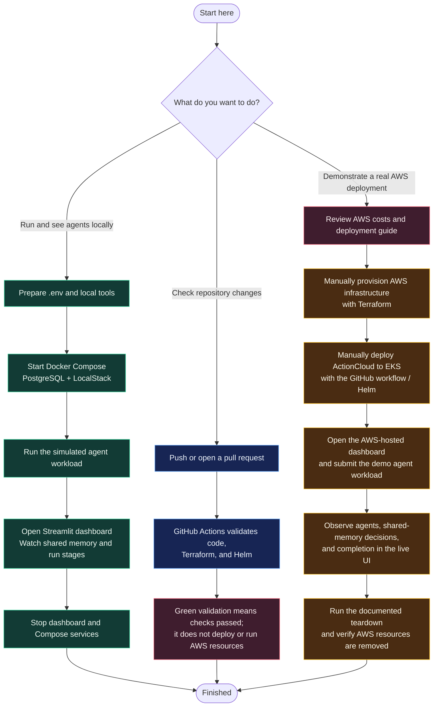

# ActionCloud

ActionCloud is a governed shared-memory service for AI agent fleets. Agents can retrieve proven procedures before work, submit new experiences, and report whether reused memories succeeded. PostgreSQL with pgvector stores the memories; role and confidence rules govern when they can be shared.

## Current deployment status

**AWS demo: decommissioned on 25 October 2026.** There is no live EKS cluster, database, or dashboard URL. The Terraform, Helm, and GitHub deployment configuration remain in this repository for a future deployment. The Terraform state bucket is retained for redeployment and may incur a small storage charge.

GitHub's green **`deployment-validation`** record means the workflow validated the deployment configuration. It does not mean ActionCloud is running in AWS. The real **Deploy ActionCloud to EKS** workflow is manual-only and requires AWS infrastructure to be provisioned first. Applying Terraform and deploying the stack create billable AWS resources.

## ActionCloud architecture

The moving dots show how memory is read, governed, stored, and surfaced in the dashboard. The drawing is visible here on GitHub and respects reduced-motion settings. Its animation explains the architecture; live agent counts and decisions appear only when the dashboard is connected to a running ActionCloud deployment.



The diagram is based on the implementation in [`src/actioncloud/service.py`](src/actioncloud/service.py), [`src/actioncloud/pipeline.py`](src/actioncloud/pipeline.py), and [`src/actioncloud/worker.py`](src/actioncloud/worker.py). [xyflow](https://github.com/xyflow/xyflow) is a React/Svelte library for interactive app canvases; GitHub README pages cannot execute that app code, so the architecture is embedded here as an animated SVG. The flow below remains clickable to guide you to the local and AWS instructions.

## Follow the workspace flow

Choose a path below. On GitHub, the diagram is rendered directly in this README; the linked nodes open the relevant setup guides.



**Recommended path:** use the local route for regular development. The AWS route creates billable resources and is currently decommissioned; follow [the AWS guide](infra/README.md) only when you intend to redeploy and monitor costs.

## Run the local demo

Prerequisites: Docker Desktop and Python 3.11 or newer. From the repository root:

```powershell
if (!(Test-Path .env)) { Copy-Item .env.example .env }
docker compose up --build -d
```

Then follow [Dashboard and live demo](dashboard/README.md) to start Streamlit and run simulated agent tasks. This local path uses PostgreSQL and LocalStack; it does not provision AWS or use AWS credits.

## Guides

- [Dashboard and live demo](dashboard/README.md)
- [AWS deployment, validation, and teardown](infra/README.md)
- [Implementation notes](IMPLEMENTATION.md)
- [External benchmark roadmap](docs/external_benchmarks_roadmap.md)

## Keep private files out of Git

Never commit `.env`, Terraform state, `*.tfvars`, or plan files. `D14_Report/`, `paper/`, `local-private/`, and the project report and review presentation are excluded from the repository. Keep local copies outside Git.
